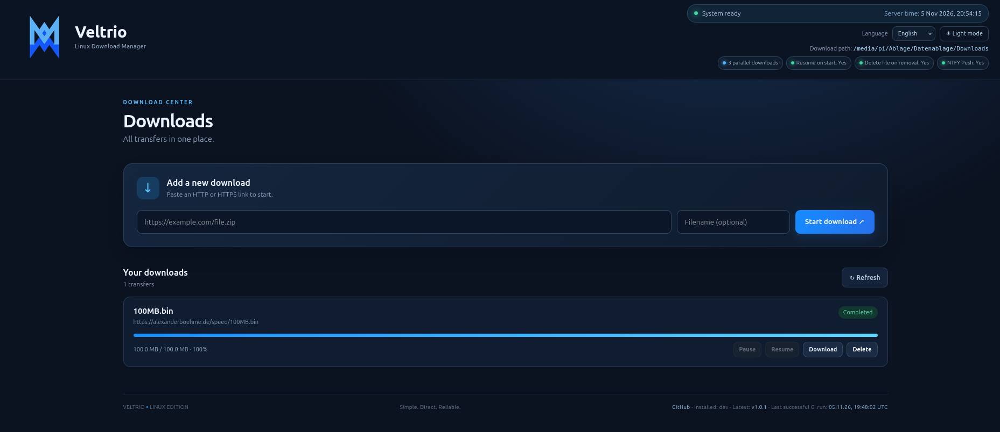

# Veltrio

Veltrio is a lightweight, self-hosted download manager for Linux, built with Go and a responsive web interface. It can run as a native Linux application or as a Docker container.

## Features

- HTTP and HTTPS downloads
- Add, pause, resume, and delete download entries
- Download completed files directly through the web interface
- Context-aware action buttons: unavailable pause, resume, and file-download actions are disabled
- Live download progress, file size, and transfer speed
- Persistent download state
- Resume interrupted downloads after a restart when the remote server supports HTTP range requests
- Configurable maximum number of concurrent downloads
- Optional NTFY push notifications for completed downloads
- Native Linux binaries for AMD64 and ARM64
- Docker image build support for Linux AMD64 and ARM64
- YAML configuration with command-line and selected environment-variable overrides
- German, English, and Spanish web interface
- Light and dark themes; the sidebar remains dark in both themes
- GitHub release and build status displayed in the web interface

> **Current scope:** Veltrio supports HTTP and HTTPS downloads. FTP, BitTorrent, browser extensions, and parallel segmented downloads are not currently implemented.



## Quick start — native Linux

Download the appropriate binary or release archive from [GitHub Releases](https://github.com/anonymous-writer/Veltrio/releases).

For example, on Linux AMD64:

```bash
chmod +x veltrio-linux-amd64
./veltrio-linux-amd64
```

On first start, Veltrio creates a `config.yaml` file if one does not already exist. By default, application data and downloads are stored in directories under the home directory of the user running Veltrio.

The web interface uses port **3010** by default:

```text
http://localhost:3010
```

## Configuration

Example `config.yaml`:

```yaml
server:
  host: "0.0.0.0"
  port: 3010

paths:
  data: "~/.local/share/veltrio"
  downloads: "~/Downloads/Veltrio"

downloads:
  max_concurrent: 3
  resume_on_start: true
  delete_file_on_remove: true

logging:
  level: "info"

# NTFY Push notifications (optional)
ntfy_enabled: false
ntfy_debug: false
database_debug: false # reserved/status setting; no database backend is currently used
ntfy_url: "https://ntfy.example.com/veltrio"
ntfy_token: ""
ntfy_notify_unknown_ipv4: false # currently has no effect in Veltrio's download-manager scope
ntfy_priority: "high"
ntfy_timeout_seconds: 10
```

The `~` prefix and environment variables inside configured paths are expanded for the user running Veltrio.

### Configuration options

| Setting | Description |
|---|---|
| `server.host` | Address on which the web server listens. |
| `server.port` | Web interface port; defaults to `3010`. |
| `paths.data` | Directory for application state and configuration. |
| `paths.downloads` | Directory for downloaded files. |
| `downloads.max_concurrent` | Maximum number of concurrent downloads; valid range is 1–64. |
| `downloads.resume_on_start` | Automatically resume eligible queued or paused downloads after startup. |
| `downloads.delete_file_on_remove` | Also delete the downloaded file when its entry is removed. |
| `logging.level` | `debug`, `info`, `warn`, or `error`. |
| `ntfy_enabled` | Enable NTFY completion notifications. |
| `ntfy_debug` | Enable NTFY diagnostic logging. |
| `database_debug` | Retained configuration/status setting; Veltrio currently stores state in a JSON file and does not use a database backend. |
| `ntfy_url` | Full NTFY topic URL. |
| `ntfy_token` | Optional NTFY access token. Keep it private. |
| `ntfy_notify_unknown_ipv4` | Accepted for configuration compatibility; currently has no effect in Veltrio's download-manager scope. |
| `ntfy_priority` | `min`, `low`, `default`, `high`, or `urgent`. |
| `ntfy_timeout_seconds` | NTFY request timeout, from 1 to 120 seconds. |

NTFY settings are read from `config.yaml`. Do not publish a configuration file containing a real NTFY token.

## Command-line options

```bash
veltrio --help
veltrio --version
veltrio --config /path/to/config.yaml
veltrio --port 3010
veltrio --host 127.0.0.1
veltrio --data /path/to/data
veltrio --downloads /path/to/downloads
```

The effective configuration precedence is:

1. Explicit command-line options
2. Supported environment variables
3. Values in `config.yaml`
4. Built-in defaults

Supported environment variables:

| Variable | Purpose |
|---|---|
| `VELTRIO_CONFIG` | Path to the configuration file |
| `VELTRIO_ADDR` | Listen address in `host:port` form, or `:port` |
| `VELTRIO_DATA` | Application data directory |
| `VELTRIO_DOWNLOADS` | Download directory |

The environment variables above are the supported overrides; arbitrary YAML settings are not automatically mapped to environment variables.

## Running with Docker Compose

The repository includes a `Dockerfile` and `compose.yaml`. From the project directory, run:

```bash
docker compose up -d --build
```

Open:

```text
http://localhost:3010
```

The included Compose file builds the image locally. It mounts:

- `./data` to `/app/data` for the configuration and persistent application state
- `./Downloads` to `/app/Downloads` for downloaded files

The container listens on port `3010`. The container runs as an unprivileged `veltrio` user. Ensure the host directories are writable by the container user if you encounter permission errors.

To stop the container:

```bash
docker compose down
```

To update a locally built image after changing the source:

```bash
docker compose up -d --build
```

## Running an image from Docker Hub

After a Veltrio image has been published to Docker Hub, it can be started without building from source. Replace `DOCKERHUB_NAMESPACE` with the Docker Hub user or organization that owns the image:

```bash
docker pull DOCKERHUB_NAMESPACE/veltrio:latest

mkdir -p ./veltrio-data ./veltrio-downloads

docker run -d \
  --name veltrio \
  --restart unless-stopped \
  -p 3010:3010 \
  -v "$(pwd)/veltrio-data:/app/data" \
  -v "$(pwd)/veltrio-downloads:/app/Downloads" \
  DOCKERHUB_NAMESPACE/veltrio:latest
```

Then open `http://localhost:3010`.

For a version-pinned deployment, replace `latest` with a published version tag. See [`README-DOCKER-HUB.md`](README-DOCKER-HUB.md) for Docker Hub usage details.

## Native builds

Requirements: Go version specified in `go.mod`.

Run tests and build the Linux AMD64 binary:

```bash
go test ./...
go vet ./...
GOOS=linux GOARCH=amd64 CGO_ENABLED=0 go build -trimpath -o veltrio-linux-amd64 ./cmd/veltrio
```

Build the Linux ARM64 binary:

```bash
GOOS=linux GOARCH=arm64 CGO_ENABLED=0 go build -trimpath -o veltrio-linux-arm64 ./cmd/veltrio
```

## Release archives

Pushing a version tag such as `v1.0.0` triggers the GitHub Actions release workflow:

```bash
git tag v1.0.0
git push origin v1.0.0
```

The workflow builds Linux AMD64 and ARM64 binaries and publishes release assets, including:

- `veltrio-linux-amd64.tar.gz`
- `veltrio-linux-arm64.tar.gz`
- Standalone binaries for both architectures
- `SHA256SUMS`
- ARM64 installation/update assets, depending on the workflow version

For Raspberry Pi installations, follow the instructions shipped with the corresponding release archive. The update script updates the binary and restarts the existing user service; it should not replace a user-managed service unit.

## GitHub and build status

The web interface displays the latest published GitHub release and the timestamp of the most recent successful GitHub Actions run. The Veltrio host needs outbound internet access to reach the GitHub API for this information.

Repository: [github.com/anonymous-writer/Veltrio](https://github.com/anonymous-writer/Veltrio)

## Interface languages and themes

The web interface is available in German, English, and Spanish. Choose a language from the selector in the header; the selection is saved in the browser.

Light and dark themes are available. The sidebar intentionally remains dark in both themes.

## License

Veltrio is distributed under the MIT License. See [LICENSE](LICENSE) for the full license text.
