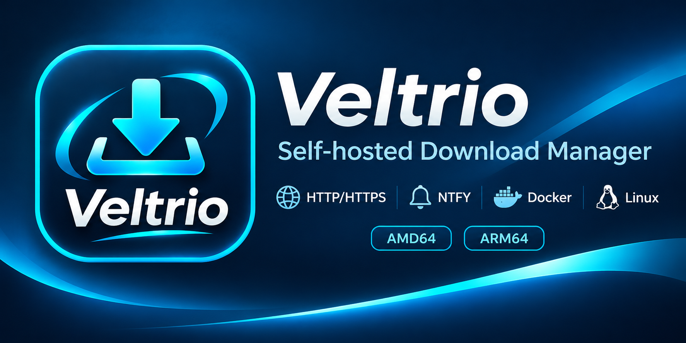
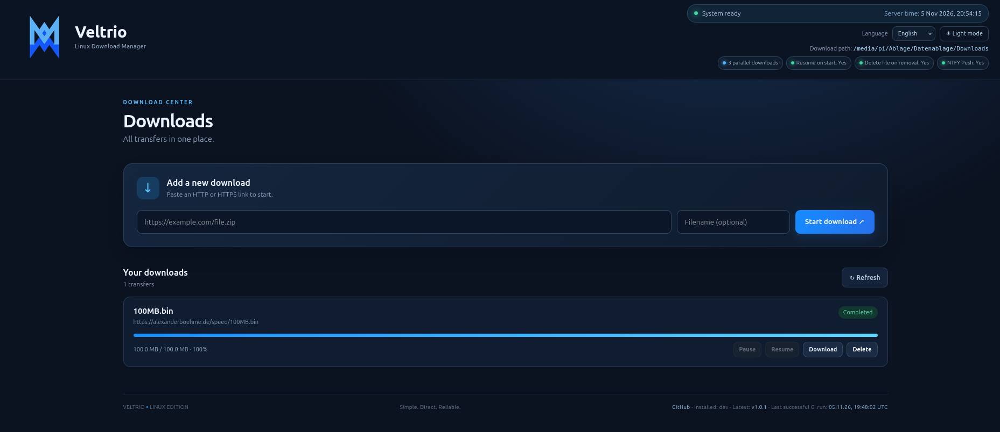

# Veltrio — Docker Hub

<p align="center">
  
</p>

<p align="center">
  <a href="https://anonymous-writer.github.io/Veltrio/">
    
  </a>
  <a href="https://hub.docker.com/r/1968michael1968/veltrio">
    
  </a>
</p>

<p align="center">
  <a href="https://github.com/anonymous-writer/Veltrio/pkgs/container/veltrio">
    
  </a>
  <a href="https://go.dev/dl/">
    
  </a>
  <a href="https://github.com/anonymous-writer/Veltrio/blob/main/LICENSE">
    
  </a>
</p>


Veltrio is a lightweight, self-hosted download manager for HTTP and HTTPS downloads. This image runs the Veltrio web application in a container and stores configuration, download state, and downloaded files in persistent mounted directories.



## Quick start

Replace `DOCKERHUB_NAMESPACE` with the Docker Hub username or organization that publishes the image.

```bash
docker pull 1968michael1968/veltrio:latest

mkdir -p ./veltrio-data ./veltrio-downloads

docker run -d \
  --name veltrio \
  --restart unless-stopped \
  -p 3010:3010 \
  -v "$(pwd)/veltrio-data:/app/data" \
  -v "$(pwd)/veltrio-downloads:/app/Downloads" \
  1968michael1968/veltrio:latest
```

Open the web interface:

```text
http://localhost:3010
```

To view logs:

```bash
docker logs -f veltrio
```

To stop and remove the container (the mounted data directories remain on the host):

```bash
docker stop veltrio
docker rm veltrio
```

## Persistent storage

Mount both directories to keep application data and downloads when the container is recreated.

| Container path | Purpose |
|---|---|
| `/app/data` | Configuration file (`config.yaml`) and persistent download state |
| `/app/Downloads` | Downloaded files |

The container creates `/app/data/config.yaml` on first start if it does not exist. The image runs as an unprivileged `veltrio` user. Make sure the host directories are writable by the container process. If necessary, inspect the container UID/GID and adjust host directory ownership or permissions rather than running the container as root.

## Configuration

The default configuration file is:

```text
/app/data/config.yaml
```

Example:

```yaml
server:
  host: "0.0.0.0"
  port: 3010

paths:
  data: "/app/data"
  downloads: "/app/Downloads"

downloads:
  max_concurrent: 3
  resume_on_start: true
  delete_file_on_remove: true

logging:
  level: "info"

# Optional NTFY push notifications
ntfy_enabled: false
ntfy_debug: false
database_debug: false # reserved/status setting; no database backend is currently used
ntfy_url: "https://ntfy.example.com/veltrio"
ntfy_token: ""
ntfy_notify_unknown_ipv4: false # currently has no effect in Veltrio's download-manager scope
ntfy_priority: "high"
ntfy_timeout_seconds: 10
```

Restart the container after changing the configuration:

```bash
docker restart veltrio
```

### NTFY in Docker

NTFY settings are read from `/app/data/config.yaml`. `ntfy_notify_unknown_ipv4` is currently a compatibility setting and has no effect in Veltrio's download-manager scope. `database_debug` is also retained for configuration/status compatibility; Veltrio currently stores state in a JSON file, not a database. Do not use `127.0.0.1` in `ntfy_url` to reach an NTFY server running on the Docker host: inside the container, `127.0.0.1` refers to the Veltrio container itself.

Use an address reachable from the container, such as the host's LAN address, or configure a suitable Docker host-gateway mapping for your platform. Keep `ntfy_token` private and do not publish it in images, examples, or public repositories.

Supported NTFY priorities are `min`, `low`, `default`, `high`, and `urgent`. The timeout must be between 1 and 120 seconds.

## Docker Compose

If you are building from the Veltrio source repository, the included `compose.yaml` builds the image locally:

```bash
docker compose up -d --build
```

It publishes port `3010` and mounts `./data` and `./Downloads` into the container. This is a source-build workflow; it does not pull the Docker Hub image by default.

## Ports and network access

| Port | Protocol | Purpose |
|---|---|---|
| `3010` | TCP | Veltrio web interface and API |

The example publishes the web interface on all host interfaces. To make it accessible only from the Docker host, change the port mapping to:

```bash
-p 127.0.0.1:3010:3010
```

If you expose Veltrio to an untrusted network, put it behind an appropriately configured reverse proxy and add your own access-control layer. The application should not be treated as an authenticated public-facing service unless access control is provided externally.

## Supported platforms

The Dockerfile uses Docker BuildKit build-platform and target-platform arguments and is intended for multi-platform builds, including:

- `linux/amd64`
- `linux/arm64`

Available platforms depend on the manifests actually published for the selected Docker Hub tag. Check the tag's platform information on Docker Hub before deploying.

## Updating

Pull the latest published image and recreate the container:

```bash
docker pull 1968michael1968/veltrio:latest
docker stop veltrio
docker rm veltrio

docker run -d \
  --name veltrio \
  --restart unless-stopped \
  -p 3010:3010 \
  -v "$(pwd)/veltrio-data:/app/data" \
  -v "$(pwd)/veltrio-downloads:/app/Downloads" \
  1968michael1968/veltrio:latest
```

Your configuration and downloads remain in the mounted host directories.

For production use, consider pinning a specific version tag instead of relying on `latest`.

## Features

- HTTP and HTTPS downloads
- Add, pause, resume, and delete download entries
- Download completed files through the web interface
- Live progress, file size, and transfer speed
- Persistent download state and optional resume after restart
- Configurable concurrent downloads
- Optional NTFY completion notifications
- German, English, and Spanish interface
- Light and dark themes

FTP, BitTorrent, browser extensions, and parallel segmented downloads are not currently supported.

## Links

- Project website: https://anonymous-writer.github.io/Veltrio/
- Docker Hub image: https://hub.docker.com/r/1968michael1968/veltrio

- Source code: https://github.com/anonymous-writer/Veltrio
- Releases: https://github.com/anonymous-writer/Veltrio/releases

## License

Veltrio is distributed under the MIT License. See [LICENSE](LICENSE) for the full license text.
